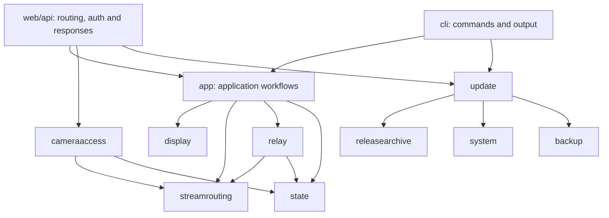

# Backend module ownership

`app.Open` composes configuration, SQLite state and application workflows. HTTP
handlers and CLI commands call those workflows or the feature module that owns
an operation. JSON fields, routes, settings keys and the database schema remain
compatible with the existing frontend.



## Where a change belongs

| Module | Owns | Entry points and test surface |
| --- | --- | --- |
| `app` | Discovery, binding workflows, viewer assembly, watchdog scheduling and support bundles | Application methods compose feature results and persist decisions. `Relays()` returns one manager per application. |
| `display` | Layout presets, custom cells, slot order, transforms and crop normalization | `Resolve(settings, slots)` and `Transform(settings, deviceID)` are deterministic and perform no I/O. |
| `streamrouting` | Direct/relay candidates, path policies, failure/recovery counters and stable selection | `Assess(ctx, input, probe)` returns an assessment and proposed state values. It never writes settings. Read-only viewer checks do not advance watchdog counters. |
| `relay` | SSH forwards, process checks, pidfiles, lifecycle locking, status and restart backoff | One `Manager` provides `Statuses`, `Start`, `Stop`, `Restart` and `Ensure`. Process/probe adapters can be replaced in tests; SQLite remains real. |
| `cameraaccess` | Camera and identity credentials, preview capture, reference images and probe results | `Service` resolves credential candidates and returns redacted results. HTTP status codes are assigned only by the transport. Capture adapters belong to an instance, so tests do not change global process state. |
| `snapshotupload` | Upload destinations, crops, privacy masks, capture timestamps, per-camera filenames/directories, JPEG preparation, FTP/SFTP transfer and interval/quiet-hour scheduling | One `Service` shares the upload lock and persisted image/file settings between manual and scheduled work. Mask writes wait for active uploads before acknowledgement. Processing masks the original frame, crops, then stamps the device-local capture time; invalid privacy settings fail closed. Empty camera directories use the global destination; overrides use remote POSIX paths. Transfers publish completed temporary files via rename, using the POSIX extension for SFTP replacement. The daemon starts `Run(ctx)` once; durable scheduling state lives in dotted SQLite settings. Tests cover actual image pixels, privacy failures, restart, quiet hours/DST and loopback FTP/SFTP, including separate directories and failed replacement. Passwords belong to `secrets`. |
| `releasearchive` | Source validation, download, digest verification against the release's `SHA256SUMS`, release CLI platform check, extraction and staging lifetime | `Prepare` returns a release with root and manifest. URL sources without an explicit digest require `SHA256SUMS`; `ExpectedDigest` serves the UI download. The caller defers `Close`. Failed preparation cleans staging. `OpenDirectory` borrows a source directory and never deletes it. |
| `update` | Catalog queries, installation, persistent jobs, exclusion, backup, recovery metadata and rollback | `Catalog.Check` owns GitHub release interpretation. Both installation and update use `releasearchive.Prepare`. The durable worker owns restart and health checks. |
| `web/api` | Route registration, request decoding, auth, cookies, HTTP errors and response encoding | Feature handlers live beside related routes. Camera operations call `cameraaccess`; release checks call `update.Catalog`. |

## Dependency rules

Feature modules do not import `app`, `web/api` or `cli`. The composition layer
supplies the endpoint resolver to `cameraaccess`; that module does not know about
`App`. The relay manager receives the configured RTSP probe from `App` and owns
its own mutex. This keeps watchdog and HTTP-triggered relay operations on the
same lifecycle lock.

Layout and path evaluation perform no direct filesystem, network or SQL I/O.
Path candidate construction consumes existing `state.Binding` records as input;
this is a type dependency, not a store opened by the evaluator. Keep persistence
in the calling workflow so a status read cannot silently become a state update.

The update package separates deployment file operations, platform setup, HTTP
health checks and metadata persistence. Archive preparation owns temporary files
in both install and update flows. The supervisor, OS lock, job ID, version check
and rollback deadline retain their existing behavior. See [recovery](recovery.md)
for operational requirements.

## Verification

`internal/architecture` tests enforce the dependency direction and the direct I/O
restriction for layout and routing. Module tests exercise stable failover,
credential fallback and redaction, reference image confinement, release staging
cleanup and real child-worker execution. Existing API, viewer and watchdog tests
continue to cover the composition of these modules.

Run `make test`; run `go test -race ./...` and `go vet ./...` inside
`camera-manager` for backend verification. CI also type-checks and builds the
frontend. Live SSH, systemd, Docker and physical camera operation still require
an appliance smoke test.

## Camera configuration and schema upgrades

Per-device `camera.credentials.<id>.username` and `.stream` settings own camera
access. Legacy binding writes update these keys and all bindings for that device
in one SQLite transaction. Settings writes, including successful identity capture,
update the binding copies in the same transaction. Migration 004 imports missing
keys from legacy bindings in slot order; existing settings win. Rendering resolves
these keys before using legacy binding values. Global passwords remain a fallback
through `secrets`; camera passwords remain outside SQLite.

`PUT /api/devices/{id}/configuration` saves a partial camera configuration. Omitted
sections keep their values. The request accepts:

```json
{
  "access": {"username": "camera-user", "password": "", "stream": "stream2"},
  "name": "Hof",
  "visible": true,
  "path_policy": "auto",
  "display": {"rotation": "90", "mirror": "false", "fit_mode": "contain"},
  "endpoint": {"host": "", "port": ""},
  "relay_endpoints": {
    "nas": {"host": "127.0.0.1", "port": "15541", "target_host": "", "target_port": ""}
  }
}
```

Display keys use existing dotted-setting suffixes and string values, including
`flip` and `crop_x`, `crop_y`, `crop_width`, `crop_height` in percent. Empty endpoint
fields restore existing defaults. A supplied access section replaces username and
stream, defaulting empty stream to `stream2`; empty password keeps the saved secret.
A supplied relay entry replaces its four endpoint fields. The relay manager
reconciles changed SSH forward arguments before rendering, including visibility
and path-policy changes. Removing the last forward stops the managed process.
Disabled, manual and external relays retain their lifecycle; manual and external
changes return warnings requiring operator action. Unchanged relays are not started.
The previous forward definitions commit with desired state as durable retry data
and remain until the complete apply succeeds. Relay lifecycle locking precedes
the go2rtc render lock, matching watchdog order.

Visibility selects a free slot under the SQLite write lock, preserves an existing
slot and never steals another device's slot. Hiding removes the device's bindings.
Name, display, stream settings, endpoints and visibility commit together. Password
writes precede that transaction and cannot participate in SQLite rollback.

Successful responses are HTTP 200 with `persisted`, `password_persisted`, `applied`,
`restarted` booleans, optional redacted `error`, and optional rendering `warnings`. A rendering/restart failure also
returns 200 with `persisted: true`, `applied: false`, and `error`. Clients must check
`applied`. An identical retry attempts the pending apply again. The pending marker
commits with stream changes. Display-only saves do not render or restart unless an
apply is pending. Stream changes render and compare generated bytes; only changed
output or a previously failed apply restarts go2rtc. Configuration validation uses
400, missing devices 404, unavailable slots 409, and persistence failures 500.
These operation failures include the result booleans; malformed JSON returns the
standard HTTP error body. `password_persisted` reports a separate secret write even
when the database transaction fails. Responses never echo submitted passwords.

`camera-manager/migrations/*.sql` is the runtime schema source, embedded in the
binary and recorded in `schema_migrations`. A dedicated connection holds
`BEGIN IMMEDIATE` through version checks, DDL and version inserts. WAL setup retries
SQLite lock contention within five seconds. Migration 002
checks for the name column already created by unversioned installed releases;
other legacy tables and auth sessions remain intact. `Open`, `Migrate`, and
`RestoreSnapshot` retain their contracts and share the same migration runner.
